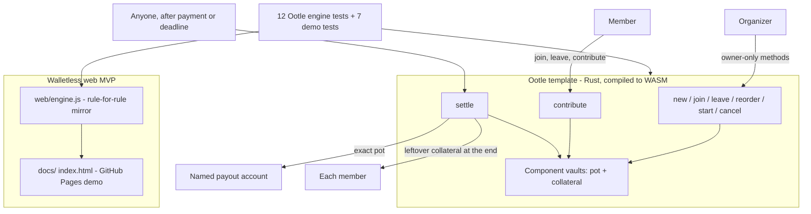
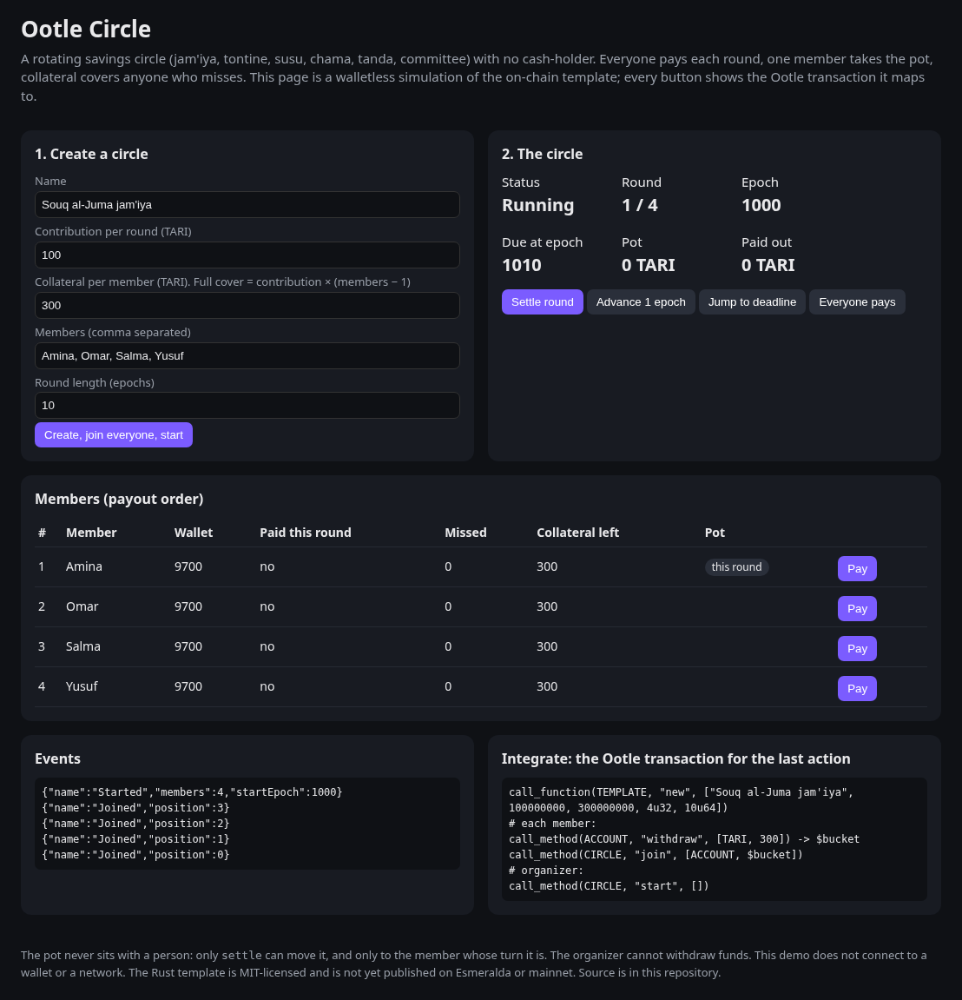
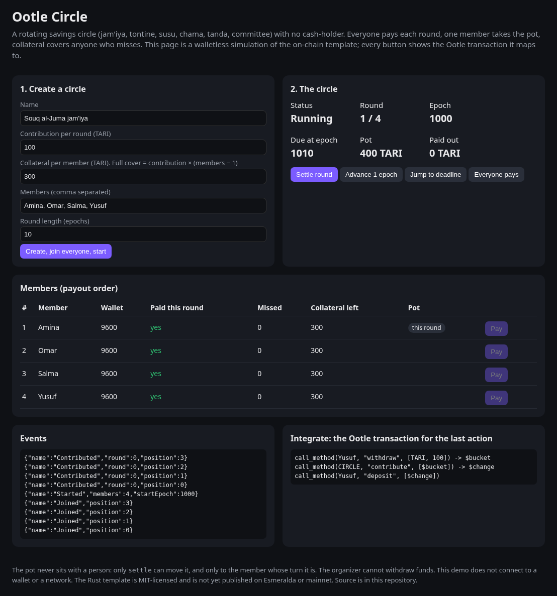
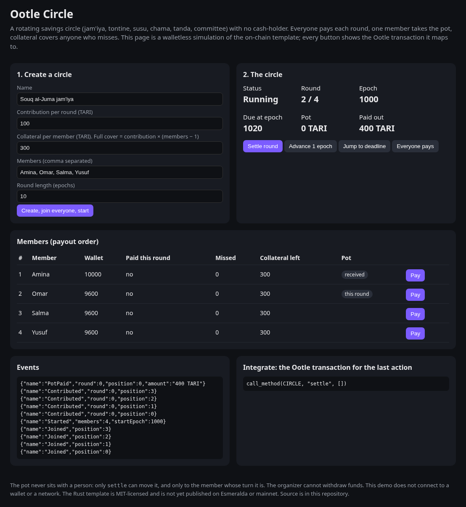
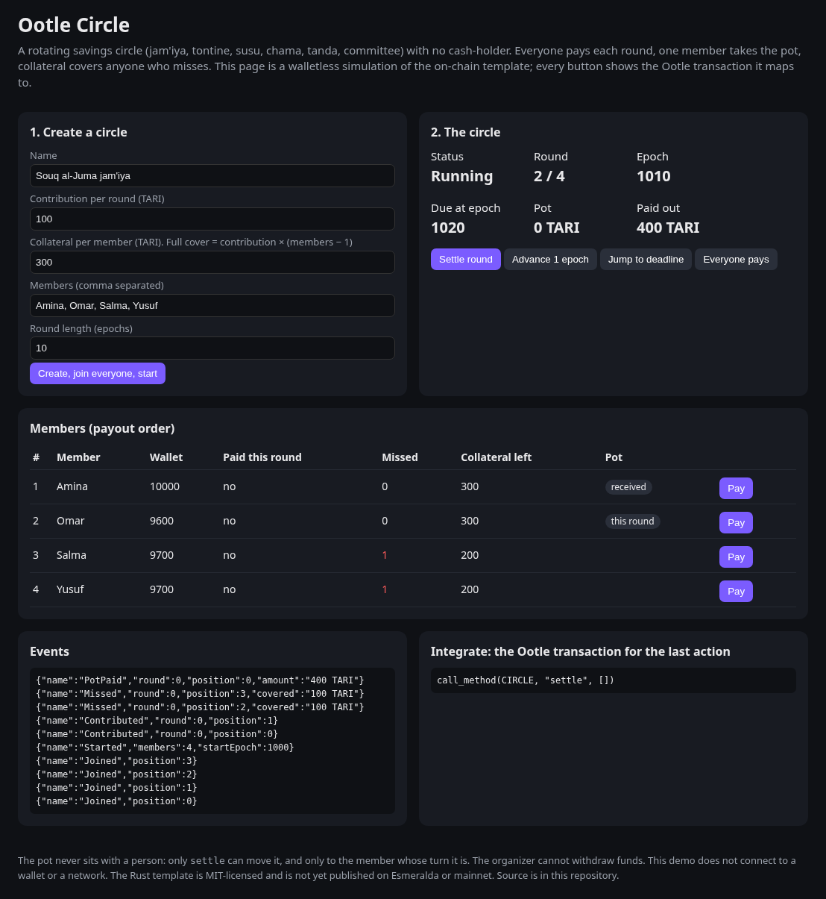

# Ootle Circle

A rotating savings circle (ROSCA) on [Tari](https://tari.com) Ootle.

Live demo: https://khazmi-lab.github.io/ootle-circle/ · Code: https://github.com/Khazmi-lab/ootle-circle

Hundreds of millions of people already save this way: a jam'iya in North Africa, a tontine in West Africa, a susu in Ghana and the Caribbean, a chama in Kenya, a committee in Pakistan, a tanda in Mexico. Every member pays the same amount each round, and one member takes the whole pot, in an agreed order, until everyone has had a turn.

A paper circle has two weak points: one person holds the cash, and a member who has already taken the pot can stop paying. Ootle Circle removes the cash-holder and makes the promise enforceable.

This is an entry for the [Tari November Build Contest: MVP](https://community.tari.com/t/november-build-contest-thread-mvp/520). The demo below is a walletless browser simulation of the on-chain template. The template has not been published to Esmeralda or mainnet.

## Why it is an MVP

The users already exist and already save this way. The product only removes the two things that break paper circles.

- The pot sits in the component vault. Only `settle` moves it, and only to the member whose turn it is.
- Every member locks collateral when joining. A missed round is covered from the late member's collateral, so the recipient still gets the full pot. With `collateral = contribution × (members − 1)`, nobody can take out more than they put in.
- Anyone can `settle` once everyone has paid or the deadline epoch has passed, so the circle keeps moving if the organizer disappears. Deadlines follow a fixed schedule.
- Members are identified by their signing key. The organizer can reorder, start or cancel, but can never touch the funds.
- When the last round settles, all remaining collateral is returned automatically.

## How it works

| Step | Who | Method |
| --- | --- | --- |
| Create a circle: name, contribution, collateral, max members, round length in epochs | organizer | `new` |
| Join with exactly the collateral and name the account that gets paid | anyone | `join` |
| Leave before the start (collateral returned) | member | `leave` |
| Set the payout order before the start | organizer | `reorder` |
| Close membership and start round 0 | organizer | `start` |
| Cancel before the start (all collateral returned) | organizer | `cancel` |
| Pay this round's contribution (overpayment comes back as change) | member | `contribute` |
| Close the round: cover missed payments from collateral, pay the pot, open the next round; after the last round, return all collateral | **anyone**, once everyone has paid or the deadline epoch has passed | `settle` |
| Read state | anyone | `info`, `member` |

## Architecture



The demo never holds keys and does not talk to a network. Each button shows the Ootle transaction it maps to, so a wallet integration can call the same methods later.

## Screenshots

The demo starts a four-member circle (100 TARI per round, 300 TARI collateral). Full cover is `contribution × (members − 1) = 300`.









## What's in this repo

- `template/`: the Rust template (`tari_template_lib` 0.38), compiled to WASM (about 146 KB release build).
- `template/tests/circle.rs`: 12 engine tests with `tari_template_test_tooling` 0.50.1. They run the compiled WASM through the Ootle engine and check exact balances: a full 3-member circle where everyone ends where they started, payout order, a missed payment covered from collateral, collateral running out, the fixed deadline schedule, change on overpayment, double payment, outsiders, organizer-only methods, reorder, join/leave/cancel rules, bad parameters and `info`.
- `web/`: the walletless browser MVP. `engine.js` mirrors the template rule for rule (7 Node tests).
- `docs/`: the same demo, ready for GitHub Pages (enable Pages from the `docs/` folder on the default branch). Includes `.nojekyll` and the screenshots above.

## Build and test

```bash
# Template: 12 engine tests (needs a Rust toolchain with the wasm32-unknown-unknown target)
cd template
cargo test
cargo build --target wasm32-unknown-unknown --release
# WASM lands at target/wasm32-unknown-unknown/release/ootle_circle.wasm

# Demo engine: 7 tests (Node 18+)
cd ../web
node --test engine.test.mjs

# Open the demo locally
python3 -m http.server -d ../docs 8000
# then open http://localhost:8000
# Optional scenes: ?scene=paid  ?scene=settled  ?scene=missed
```

## Honest notes

- The demo is a browser simulation. The template has not been published to Esmeralda or mainnet.
- Contributions and payouts are revealed TARI amounts in a component vault, so the size of the pot is public. Private contributions are a next step.
- There is no lottery for the order: the organizer sets it before the start, and every member can see it before paying anything.
- This is new code written for this contest round. It does not borrow from earlier entries.

## License

[MIT](LICENSE) © 2026 Metaz Al Khazmi.
